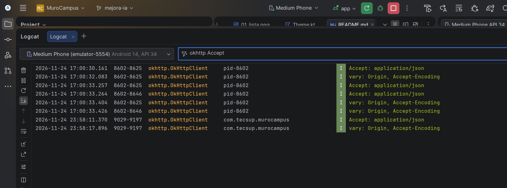
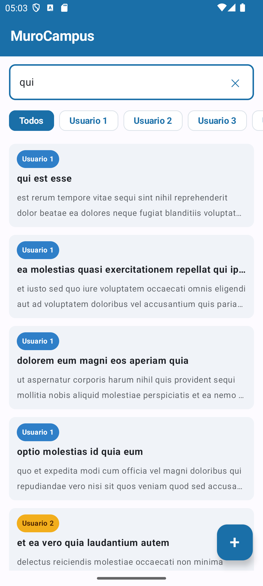
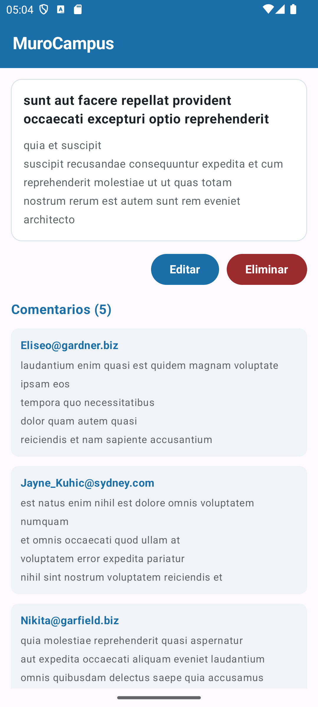
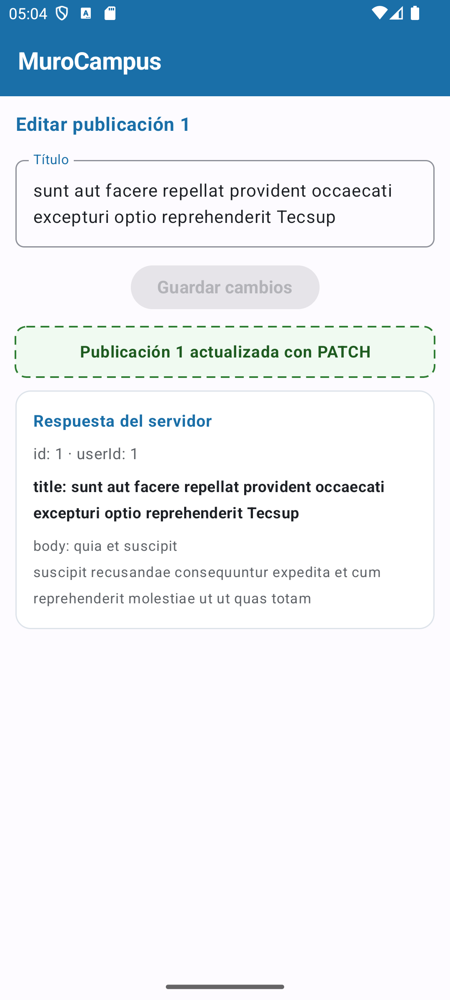
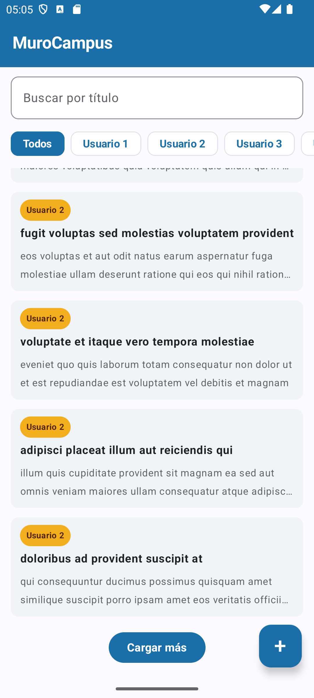
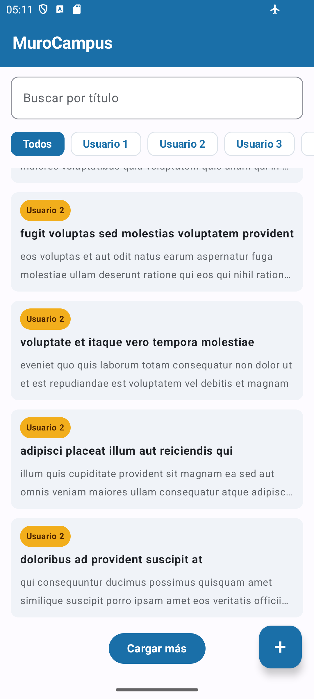

# PROMPTS.md · Fase 2 (rama `mejora-ia`)

**Estudiante:** Jordan Alonso Abad Mejia
**Asistente de IA usado:** Claude (Anthropic)
**Rama:** `mejora-ia`, creada desde `main` después del commit `docs: agrega README con estructura y capturas`.

Lo escribió la IA, lo revisó el estudiante. En cada mejora se probó la app, se revisó en Logcat la petición HTTP y se comprobó que cada capa siguiera respetando su responsabilidad: la View solo conoce al ViewModel, el ViewModel solo conoce la interface `PostRepository`, y el Repository nunca deja escapar excepciones.

## Mejoras implementadas

| # | Mejora | Capas que cambian | Commit |
|---|---|---|---|
| 1 | Encabezado `Accept: application/json` con Interceptor | RetrofitClient | `feat(red): agrega interceptor que envia Accept application/json` |
| 2 | Búsqueda por título sobre lo descargado | ViewModel + View | `feat(busqueda): filtra por titulo las publicaciones descargadas` |
| 3 | Borrar con `@DELETE` y `Response<Unit>` | API + Repository + ViewModel + View | `feat(borrar): elimina publicacion con DELETE y Response<Unit>` |
| 4 | Editar el título con `@PATCH` | API + Repository + ViewModel + View | `feat(editar): modifica el titulo con PATCH y muestra la respuesta` |
| 5 | Paginación de 20 en 20 con `_start` y `_limit` | API + Repository + ViewModel + View | `feat(paginacion): carga publicaciones de 20 en 20 con _start y _limit` |
| 6 | Caché en Room: sin internet muestra lo guardado | Repository + Room | `feat(cache): guarda publicaciones en Room y las muestra sin internet` |

## Registro de prompts

| Prompt | Qué generó la IA | Qué cambié o descarté | Por qué |
|---|---|---|---|
| "Empecemos con la fase dos, haremos todas las mejoras que se piden" | Un plan con las 6 mejoras, un commit por mejora, en el orden de la tabla anterior | La IA no escribió la mejora 1 hasta confirmar que el commit 11 estaba subido y que la rama `mejora-ia` existía | Escribir el código antes habría mezclado la mejora con el commit del README en `main` |
| Mejora 1: interceptor | La clase `AcceptJsonInterceptor` y su registro en `RetrofitClient` | El interceptor se registró **antes** del `HttpLoggingInterceptor` | Así Logcat muestra la petición ya con el encabezado `Accept` y se puede comprobar que se envía |
| Mejora 2: búsqueda | `busqueda`, `buscar()` y `visibles` con `combine` + `stateIn` en el ViewModel, más el campo de búsqueda en la lista | Se eligió `SharingStarted.Eagerly` en vez de `WhileSubscribed` | Con `WhileSubscribed`, al volver del detalle la lista podía pasar un instante por `Cargando` y perder la posición del scroll |
| Mejora 3: borrar | `@DELETE` con `Response<Unit>`, revisión de `isSuccessful`, botón Eliminar con diálogo de confirmación y aviso | **Error corregido:** en la primera versión el aviso "Publicación N eliminada" se cancelaba solo. Se reemplazó `LaunchedEffect(borrado)` por un `LaunchedEffect(Unit)` que hace `collect` del `StateFlow` | Al poner el estado en `null`, cambiaba la clave del `LaunchedEffect`, la corrutina se reiniciaba y se cancelaba el `showSnackbar` |
| Mejora 3: borrar | Quitar de la lista local la publicación borrada | Se dejó así a propósito | JSONPlaceholder responde 200 pero no borra de verdad; sin esto la publicación seguiría apareciendo |
| Mejora 4: editar | `@PATCH("posts/{id}")` con el modelo `CambioTitulo(title)` y la pantalla Editar con la respuesta del servidor | Se usó PATCH y no PUT. El recuadro verde se movió a `Componentes.kt` para que lo usen Crear y Editar | PATCH envía solo el campo que cambia; PUT obliga a mandar el recurso completo. Mover el componente evita tener el mismo código dos veces |
| Mejora 4: editar | Actualizar la lista y el detalle con el `Post` que devuelve el servidor | El botón Guardar se deshabilita si el título está vacío o no cambió | Evita peticiones inútiles |
| Mejora 5: paginación | `pagina(inicio, limite)` con `@Query("_start")` y `@Query("_limit")`, la función `cargarMas()` y el botón "Cargar más" | **Riesgo evitado:** la siguiente página se calcula con un contador propio (`siguienteInicio`) y no con el tamaño de la lista. Además se agregó `distinctBy { it.id }` | Si se borra una publicación, la lista se achica; con su tamaño se pediría una página corrida y se repetiría un `id`. `LazyColumn` falla con claves repetidas |
| Mejora 5: paginación | Error al cargar más | El error se muestra en el pie de la lista, con Reintentar, sin borrar lo ya cargado | Perder 40 publicaciones por un fallo de la página 3 sería mala experiencia |
| Mejora 6: Room | `PostEntity`, `PostDao` y `MuroDatabase`, más un `PostRepositoryCache` que envuelve al remoto | Solo se leen datos de Room cuando el error es `IOException` (sin conexión). Un 404 o un 500 se muestran igual que antes | Room no arregla un error del servidor; ocultarlo confundiría al usuario |
| Mejora 6: Room | Manejo de errores de Room | **Sin `catch` vacío:** los errores de Room se registran con `Log.w` y la `CancellationException` se vuelve a lanzar | La guía pide revisar que la IA no "trague" excepciones |
| Mejora 6: Room | Dependencias | KSP **2.3.10** y Room **2.8.4** | El proyecto usa AGP 9 con Kotlin integrado; las versiones de KSP anteriores a 2.3.1 no lo soportan |

## Revisión del código generado (checklist de la guía)

| Qué se revisó | Resultado |
|---|---|
| ¿Retrofit, `PostApi` o `HttpException` dentro de `PostsViewModel`? | No. El ViewModel solo usa la interface `PostRepository` |
| ¿`Context` dentro del ViewModel? | No. La base de Room se crea en `MainActivity` y se pasa al Repository |
| ¿Alguna excepción "tragada" (catch vacío)? | No. `llamar()` convierte los errores en `Result.failure` y la caché registra con `Log.w` |
| ¿Se respeta la `CancellationException`? | Sí, se vuelve a lanzar en `PostRepositoryRemote` y en `PostRepositoryCache` |
| ¿Las rutas empiezan con `/`? | No: `posts`, `posts/{id}`, `posts/{id}/comments` |
| ¿Las pantallas siguen mostrando Cargando, Éxito y Error? | Sí, también en Borrar, Editar y Cargar más |
| ¿Un commit por mejora? | Sí, 6 commits en `mejora-ia`, uno por mejora |

## Evidencias

| Mejora | Captura |
|---|---|
| 1 · Interceptor (Logcat con `Accept: application/json`) |  |
| 2 · Búsqueda |  |
| 3 · Borrar |  |
| 4 · Editar con PATCH |  |
| 5 · Paginación |  |
| 6 · Room sin internet |  |

## Qué aprendí revisando a la IA

- El código que "compila" no siempre es correcto. El aviso de Borrar compilaba, pero se cancelaba solo por cómo funciona la clave de `LaunchedEffect`.
- Hay que pensar en cómo interactúan las mejoras: borrar más paginar podía repetir publicaciones si la página se calculaba con el tamaño de la lista.
- Room y la red se reparten responsabilidades en el Repository. El ViewModel no se enteró de que existe una base de datos, y eso demuestra que la separación MVVM + Repository funciona.
