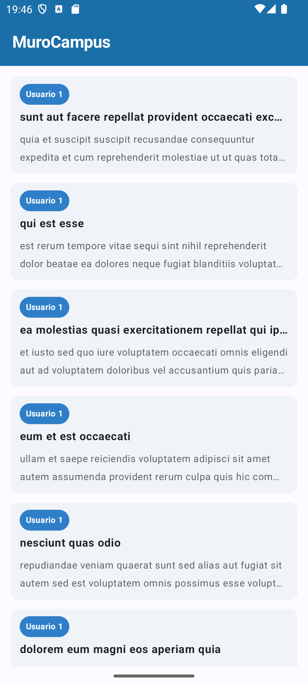
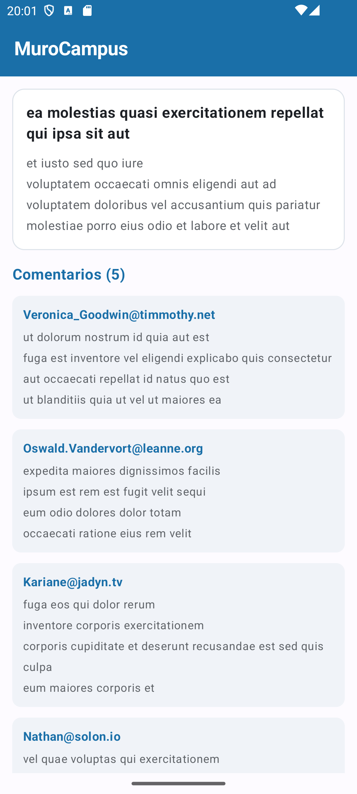
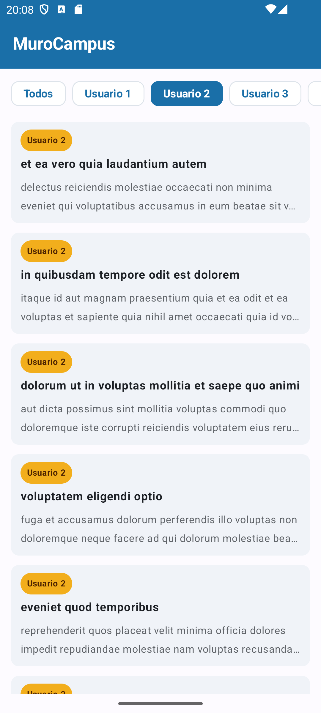
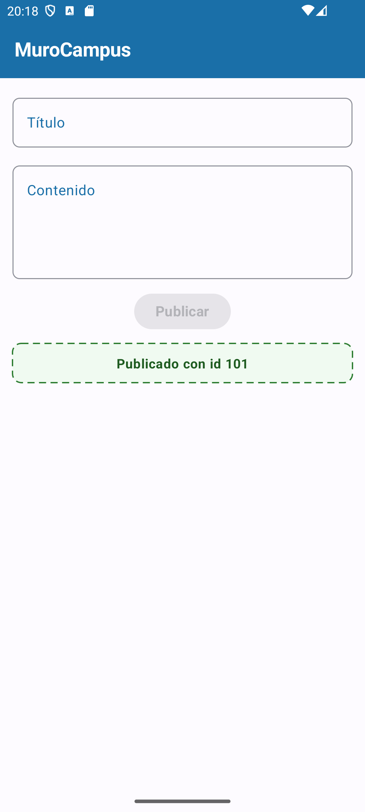
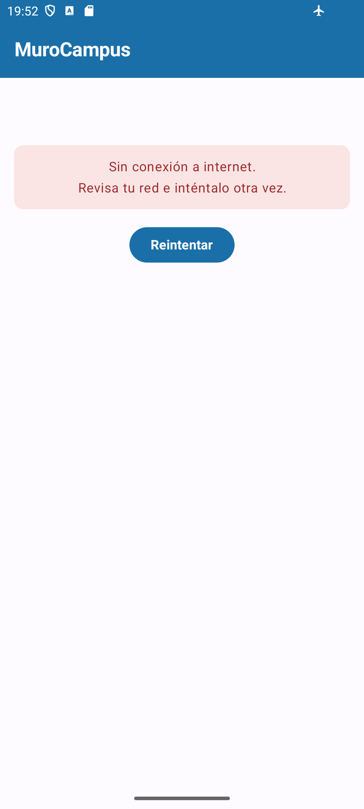

# MuroCampus

**Laboratorio:** Servicios Web y plataforma REST
**Curso:** Programación en Móviles · 4to ciclo · Diseño y Desarrollo de Software
**Docente:** Juan José León Suiyon
**Estudiante:** Jordan Alonso Abad Mejia

## Descripción

MuroCampus es una app Android hecha con Jetpack Compose que consume el servicio REST de [JSONPlaceholder](https://jsonplaceholder.typicode.com/).

- Lista las 100 publicaciones del servicio.
- Muestra el detalle de una publicación con sus comentarios.
- Filtra las publicaciones por usuario.
- Crea una publicación nueva con POST.

Cada pantalla tiene tres estados (**Cargando**, **Éxito** y **Error con Reintentar**), así que la app no se cierra cuando no hay internet o el servidor responde mal.

**Tecnologías:** Kotlin, Jetpack Compose, Material 3, Retrofit 2.11, OkHttp 4.12 con HttpLoggingInterceptor, kotlinx.serialization, corrutinas, StateFlow y ViewModel (MVVM + Repository).

## API usada

| Para… | Verbo y ruta | Anotación en `PostApi` |
|---|---|---|
| Listar publicaciones | `GET posts` | `@GET("posts")` |
| Ver una publicación | `GET posts/{id}` | `@GET("posts/{id}")` + `@Path("id")` |
| Ver sus comentarios | `GET posts/{id}/comments` | `@GET("posts/{id}/comments")` + `@Path("id")` |
| Filtrar por usuario | `GET posts?userId=2` | `@GET("posts")` + `@Query("userId")` |
| Crear una publicación | `POST posts` | `@POST("posts")` + `@Body` |

## Estructura de paquetes

```
com.tecsup.murocampus/
├── MainActivity.kt                  navegación: lista, detalle, crear y BackHandler
├── model/
│   └── Modelos.kt                   Usuario, Post, Comentario, NuevoPost
├── data/
│   ├── remote/
│   │   ├── PostApi.kt               interface de Retrofit (GET, POST, Path, Query, Body)
│   │   ├── UsuarioApi.kt            ejemplo resuelto
│   │   └── RetrofitClient.kt        Retrofit + OkHttp + conversor JSON (una sola instancia)
│   ├── PostRepository.kt            interface + PostRepositoryRemote (devuelve Result)
│   └── UsuarioRepository.kt         ejemplo resuelto
├── viewmodel/
│   ├── UiState.kt                   Cargando / Exito / Error + mensajeDe()
│   ├── PostsViewModel.kt            lista, filtro, detalle y crear
│   └── PostsViewModelFactory.kt
└── ui/
    ├── Componentes.kt               BarraMuroCampus, TarjetaPost, Cargando, ErrorConReintento
    ├── PantallaLista.kt             chips de filtro + LazyColumn
    ├── PantallaDetalle.kt           publicación + Comentarios (N)
    ├── PantallaCrear.kt             formulario + Publicar
    └── theme/                       Color.kt, Theme.kt, Type.kt
```

## Arquitectura MVVM + Repository

```
  View (PantallaLista, PantallaDetalle, PantallaCrear)
     │  eventos: cargar, filtrar, abrir, publicar        ▲ collectAsStateWithLifecycle()
     ▼                                                    │
  ViewModel (PostsViewModel) ── StateFlow<UiState> (Cargando / Exito / Error) ──┘
     │  viewModelScope.launch
     ▼
  PostRepository (interface)              ◄── devuelve Result<...>
     └─► PostRepositoryRemote             (captura IOException, HttpException, SerializationException…)
            │
            ▼
  PostApi (Retrofit) ── OkHttp ──► https://jsonplaceholder.typicode.com/
```

| Capa | Conoce a | No debe |
|---|---|---|
| View (`ui/`) | Solo a su ViewModel | Llamar a Retrofit ni conocer `PostApi` |
| ViewModel | Solo a la interface `PostRepository` | Conocer Retrofit, `HttpException` ni `Context` |
| Repository | `PostApi` y las excepciones de red | Conocer la UI ni dejar escapar excepciones |
| `data/remote` | Retrofit, OkHttp y el JSON | Guardar estado de pantalla |

## Capturas

| Lista | Detalle | Filtro (Usuario 2) |
|:---:|:---:|:---:|
|  |  |  |

| Crear (Publicado con id 101) | Error de conexión |
|:---:|:---:|
|  |  |

## Pruebas de errores (Paso 10)

| Prueba | Cómo se provocó | Resultado | OK |
|---|---|---|:---:|
| Sin internet | Modo avión y abrir la app | Sin conexión a internet y botón Reintentar | ✅ |
| Reintentar | Quitar el modo avión y pulsar Reintentar | Carga la lista | ✅ |
| Recurso inexistente | `posts/9999` en el detalle (temporal) | Error del servidor (404) | ✅ |
| JSON inesperado | Agregar a `Post` un campo que no llega (temporal) | Respuesta inesperada | ✅ |
| Cancelación | Abrir el detalle y volver rápido | Sin errores en Logcat | ✅ |
| Lista y detalle | Abrir varias publicaciones | Siempre 5 comentarios | ✅ |
| Filtro | Elegir cada usuario | Siempre 10 publicaciones | ✅ |
| Crear | Enviar una publicación | Publicado con id 101 | ✅ |
| Código | Revisar `PostsViewModel` | Sin Retrofit, `PostApi` ni `HttpException` | ✅ |

## Para pensar

**1. ¿Qué diferencia hay entre GET y POST? ¿Por qué crear lleva `@Body` y porUsuario lleva `@Query`?**

GET solo lee un recurso y no cambia nada en el servidor. Sus datos viajan en la URL y se puede repetir sin efectos. POST crea un recurso nuevo y envía los datos en el cuerpo de la petición.

`crear` lleva `@Body` porque manda un objeto completo (`NuevoPost`), que se convierte a JSON en el cuerpo. `porUsuario` lleva `@Query` porque solo filtra una colección que ya existe, con un parámetro que se agrega a la URL (`posts?userId=2`).

**2. ¿Por qué la ruta es `"posts"` y no `"/posts"`?**

Retrofit combina la ruta con la `baseUrl`.

- Una ruta relativa (`"posts"`) se agrega al final de la URL base: `https://jsonplaceholder.typicode.com/posts`.
- Una ruta que empieza con `/` es absoluta y reemplaza todo el camino de la URL base. Si la base fuera `https://servidor.com/api/v1/`, la ruta `"/posts"` iría a `https://servidor.com/posts` y se perdería `/api/v1/`.

Por eso la `baseUrl` termina en `/` y las rutas no empiezan con `/`.

**3. ¿Por qué el Repository devuelve `Result` en vez de dejar que la excepción llegue al ViewModel?**

- El error se vuelve un valor normal que el ViewModel maneja con `onSuccess` y `onFailure`, sin `try/catch` ni conocer `IOException` o `HttpException`.
- Si alguien olvida capturar una excepción, la app no se cierra.
- Las capas quedan separadas: se puede cambiar la fuente de datos (por ejemplo, Room o un repositorio falso para pruebas) sin tocar el ViewModel ni las pantallas.

La `CancellationException` sí se vuelve a lanzar, para no romper la cancelación de las corrutinas.

**4. ¿Qué pasa si olvidas el permiso INTERNET? ¿Y si olvidas `ignoreUnknownKeys` y el servidor agrega un campo nuevo?**

- **Sin el permiso INTERNET**, la app compila, pero Android bloquea el socket (`SocketException: EPERM` o `UnknownHostException`). Como es una `IOException`, la app muestra "Sin conexión a internet" aunque sí haya red.
- **Sin `ignoreUnknownKeys = true`**, kotlinx.serialization falla con `SerializationException` en cuanto el servidor agrega un campo que la `data class` no tiene. Toda la pantalla mostraría "Respuesta inesperada", aunque los datos que usamos sigan llegando bien. Con la opción activada, los campos desconocidos se ignoran y la app sigue funcionando.

**5. ¿Por qué la pantalla de lista usa un `when` sobre `UiState` y no un `if` con tres variables?**

`UiState` es una `sealed interface`: en cada momento hay un solo estado y el compilador obliga a que el `when` cubra todos los casos. Con tres variables sueltas (por ejemplo `cargando`, `error` y `datos`) pueden aparecer combinaciones imposibles, como `cargando = true` y `error != null` a la vez, o puedes olvidar limpiar una de ellas.

Además, cada estado lleva solo lo que necesita: `Exito` trae los datos y `Error` trae el mensaje.

**6. JSONPlaceholder no guarda los POST. ¿Cómo cambiaría tu app si usaras un servicio real?**

- Después de publicar, la lista tendría que mostrar la publicación nueva: o se agrega a la lista local el `Post` que devuelve el servidor, o se vuelve a cargar la lista.
- El `id` sería real y único, no siempre 101.
- El `userId` sería el del usuario que inició sesión, no un 1 fijo.
- Habría autenticación, con un token enviado en un encabezado mediante un Interceptor de OkHttp.
- Habría que manejar errores de validación del servidor (400, 401, 422) con mensajes más claros.
- Haría falta evitar envíos duplicados. Eso ya está cubierto, porque el botón se deshabilita mientras se envía.
- Convendría una caché local (Room) para ver los datos sin internet.

## Cómo ejecutar

1. Clonar el repositorio y abrirlo en Android Studio.
2. Sincronizar Gradle (Sync Now).
3. Ejecutar en un emulador o celular con internet (API 24 o superior).
